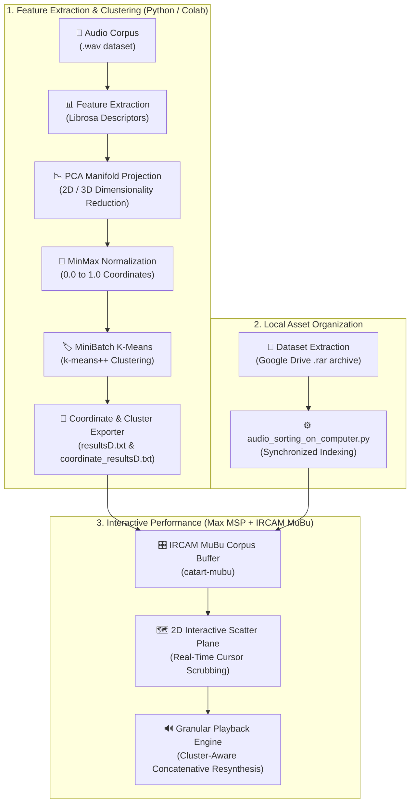

# Audio Clustering with Python and Max MSP

> **Unsupervised audio feature clustering in Python with real-time 2D corpus exploration and concatenative playback in Cycling '74 Max MSP and IRCAM MuBu.**

[](https://colab.research.google.com/github/gio961gio/Audio-Clustering-with-Python-and-Max-MSP/blob/main/Audio_Clustering_with_Python_and_Max_MSP.ipynb)
[](https://cycling74.com/)
[](https://forum.ircam.fr/projects/detail/mubu/)
[](https://www.python.org/)
[](https://scikit-learn.org/)
[](https://librosa.org/)

---

## 🎧 Overview

**Audio-Clustering-with-Python-and-Max-MSP** combines machine learning-based audio feature analysis with real-time interactive performance. The system extracts acoustic descriptors from large audio corpora, projects them into a low-dimensional manifold via **Principal Component Analysis (PCA)**, clusters them using **MiniBatch K-Means**, and maps the resulting feature space directly into an interactive 2D descriptor space within **Cycling '74 Max MSP** powered by **IRCAM's MuBu and CataRT** systems.

Performers can dynamically explore, scrub, and trigger audio samples across the 2D cluster map using intuitive mouse or controller gestures, turning algorithmic clustering into an expressive sound design instrument.

---

## 🎬 Video Demonstration

Click below to see the interactive 2D cluster navigation and granular playback in Max MSP in action:

[▶️ **Watch the Interactive Max MSP Demonstration**](https://github.com/gio961gio/Audio-Clustering-with-Python-and-Max-MSP/assets/163283326/12cd0bdb-981a-407a-b7e5-aead425c3c5f)

---

## 🔬 System Workflow & Architecture



---

## 📋 Prerequisites

1. **Cycling '74 Max 8+** installed on your computer.
2. **IRCAM MuBu Packages:** Inside Max MSP, open the **Package Manager** (`File > Show Package Manager`) and install:
   - `MuBu for Max`
   - `catart-mubu`


---

## 🚀 Step-by-Step Execution Guide

### Phase 1: Feature Extraction & Clustering in Python (Colab)
1. Open the [Google Colab Notebook](https://colab.research.google.com/github/gio961gio/Audio-Clustering-with-Python-and-Max-MSP/blob/main/Audio_Clustering_with_Python_and_Max_MSP.ipynb).
2. Execute the cells to download the audio dataset, extract audio features, run PCA dimensionality reduction, and execute MiniBatch K-Means.
3. In the **"Files for Max MSP"** section, download the two generated export files:
   - `resultsD.txt` (Cluster associations and index mapping)
   - `coordinate_resultsD.txt` (Normalized $X, Y$ coordinates)

### Phase 2: Local Dataset Preparation
1. Download the audio dataset archive (.rar) from the [Google Drive Dataset Link](https://drive.google.com/file/d/1QBaEbp3psMadVr3cgdACvT_43bka7tvO/view?usp=drive_link) (or provide your own custom corpus).
2. In the `Max_Msp_and_Python scripts/` directory, run the Python sorting scripts in sequence:
   ```bash
   python audio_extraction_on_computer.py
   python audio_sorting_on_computer.py
   ```
   This ensures that local audio files match the exact indexing sequence produced during the Colab clustering stage.

### Phase 3: Loading the Max MSP Patch
1. Open `Max_Msp_and_Python scripts/Clustering Multi Audio Tracks.maxpat` in Max MSP.
2. Locate the two primary initialization subpatches:


3. **Cluster Initialization (`p inizializzazione` - highlighted in red):**  
   Open the subpatch and paste the contents of `resultsD.txt` into the message boxes (preceded by `track 1 append`). Multiple message boxes can be chained for large datasets:


4. **Coordinate Mapping (`p append x:y` - highlighted in blue):**  
   Open the subpatch and paste the contents of `coordinate_resultsD.txt` into the message box:


5. **Audio Directory Path:**  
   In the bottom-right corner of the patch, update the `readfolder` message box with the absolute local path to your extracted audio directory:


6. Save the patch, restart it, and enjoy exploring your audio corpus in real time!

---

## ⚙️ Clustering Parameters & Metrics

| Parameter | Default | Description |
| :--- | :---: | :--- |
| `n_clusters` | `4` | Number of distinct K-Means clusters to partition the corpus. |
| `init` | `'k-means++'` | Initialization method ensuring optimal cluster centroid dispersion. |
| `n_init` | `100` | Number of random initializations evaluated. |
| `max_iter` | `10` | Maximum solver iterations for MiniBatch K-Means convergence. |
| `Silhouette Score` | Evaluated in Colab | Measures intra-cluster cohesion versus nearest-cluster separation. |
| `PCA Dimensions` | `2D / 3D` | Reduces high-dimensional feature vectors into 2D/3D coordinates normalized to $[0, 1]$. |

---

## 🛠️ Repository Structure

```
Audio-Clustering-with-Python-and-Max-MSP/
├── Audio_Clustering_with_Python_and_Max_MSP.ipynb    # Google Colab feature extraction & clustering notebook
├── audio_stuff.py                                    # Audio feature extraction and segmentation utilities
├── Max_Msp_and_Python scripts/
│   ├── Clustering Multi Audio Tracks.maxpat          # Main Cycling '74 Max MSP performance patch
│   ├── audio_extraction_on_computer.py               # Local dataset decompression & preparation
│   └── audio_sorting_on_computer.py                  # Local audio indexing alignment script
└── README.md                                         # Project documentation
```

---

## 📚 Acknowledgments & References

* **IRCAM:** [MuBu for Max](https://forum.ircam.fr/projects/detail/mubu/) & [CataRT](https://forum.ircam.fr/projects/detail/catart/) for corpus-based concatenative synthesis.
* **Cycling '74:** [Max MSP](https://cycling74.com/) visual programming environment.
* **Scikit-Learn:** Unsupervised machine learning algorithms (`PCA`, `MiniBatchKMeans`, `silhouette_score`).
* **Librosa:** [librosa](https://librosa.org/) audio and music signal processing in Python.
